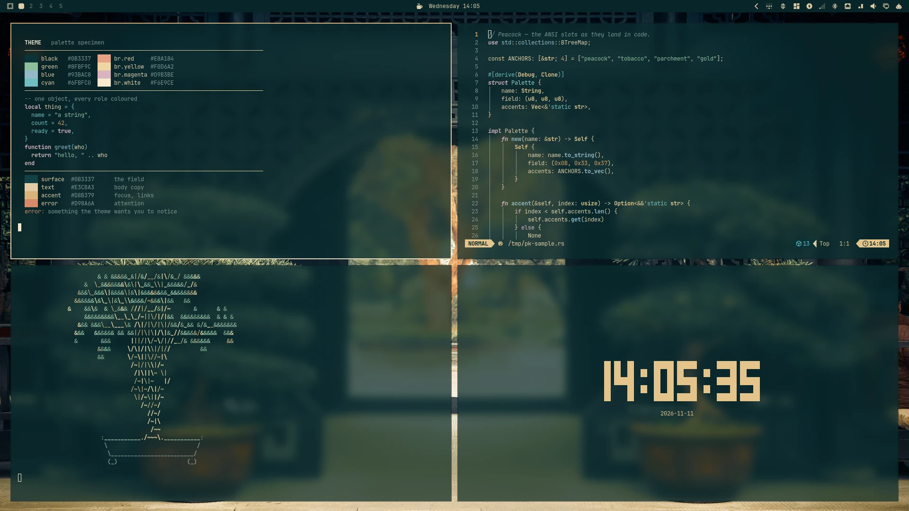
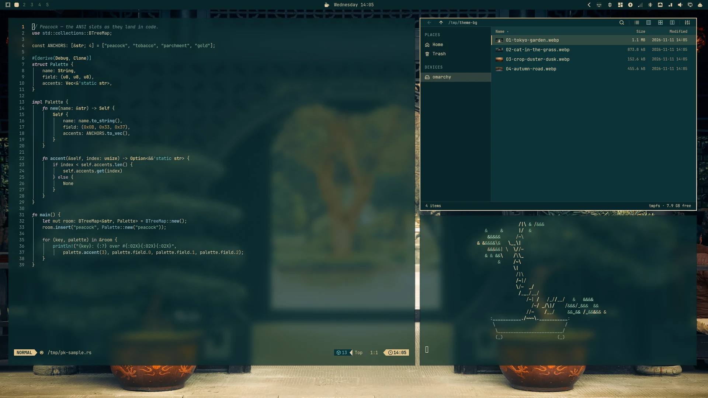
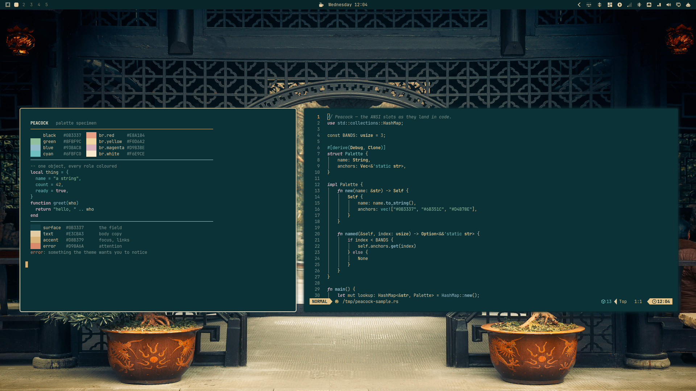

# Peacock

An Omarchy theme built from a three-colour card: peacock `#0B3337` for the
field, tobacco `#6B351C` for selection and pressed fills, parchment `#D4B78E`
for body text, and gold `#D8B379` for the lettering. Every other token is a
lift or drop of those four; hue only leaves them for the status and code slots,
at lightness that keeps text at or above 4.5:1 on the field.





The gold-to-parchment gradient rides the focused window, the bar and the popups;
the selection is a warm tobacco so parchment text stays readable at 8.6:1.

| Anchor | Hex | Role |
|---|---|---|
| Peacock | `#0B3337` | windows, panels, terminal paper |
| Tobacco | `#6B351C` | selection, pressed fills |
| Parchment | `#D4B78E` | body text (8.6:1 on the field) |
| Gold | `#D8B379` | accent, active border, links (6.9:1) |

---

## Apply

```bash
omarchy theme install https://github.com/Binz120/peacock
```

`omarchy theme install` clones the repo and applies it. The repository name is
the theme slug, so it arrives as `peacock` and lists as Peacock. A repository
install drops `hyprland.lua` and the terminal configs; the palette, shell
surfaces, GTK sheet, btop theme and wallpapers all survive, and the workspace
geometry falls back to the generated defaults.

## Wallpapers

Four stills ship as WebP, the garden first on apply; cycle them with
`omarchy theme bg next`.

- `01-tokyo-garden.webp` — [wallhaven oxqyxm](https://wallhaven.cc/w/oxqyxm), 3840×2160
- `02-cat-in-the-grass.webp` — [wallhaven k7dz96](https://wallhaven.cc/w/k7dz96), 3840×2160
- `03-crop-duster-dusk.webp` — [wallhaven 4gepx7](https://wallhaven.cc/w/4gepx7), 1920×1080
- `04-autumn-road.webp` — [wallhaven vg8y95](https://wallhaven.cc/w/vg8y95), 1920×1080

Each still has a matching six-second intro clip in `backgrounds/intros/`, same
name, 1920×1080 and silent: it opens at 1.08× and settles onto the still, and
Omarchy plays it at login and when that wallpaper is selected, crossfading into
the image. Your own wallpapers live outside the theme, in
`~/.config/omarchy/backgrounds/peacock/`.

## Files

- `colors.toml` — the palette every Omarchy consumer reads
- `shell.toml` — bar, popups, launcher, menu, lock, polkit, notifications
- `gtk.css` — GTK3, GTK4 and libadwaita, including the list/columnview rows a
  symbol-only sheet leaves on Adwaita
- `btop.theme`, `chromium.theme`, `icons.theme`
- `unlock.png` (800×188, transparent gold wordmark) and `preview-unlock.png`
  (1920×1080) — the boot-decryption design shown under Appearance → Unlock
- `backgrounds/` — the four stills above and their `intros/` clips
- `preview.webp`, `preview-busy.webp`, `preview-work.webp` — 1920×1080 captures:
  the desktop, four tiled terminals, and an editor-plus-Flea work screen

## Notes

- The theme directory and this repository are the same file set. There are no
  local-only overrides: `hyprland.lua`, the terminal configs and `vscode.json`
  are rendered from `colors.toml` at staging and never live in the theme.
- GTK deviations are deliberate: row hover is a gold tint over the view rather
  than flat `lighter_background`, disabled buttons sit on the field colour, and
  tooltips use `darker_background`. Measured with `measure-gtk-theme.py`, every
  text/background pair clears 3:1 and body text clears 4.5:1.
- `pressed-color`, `selection-color`, `heading`, `icon-large` and the per-section
  `border-width` keys are read by the shell (`Style.qml`, `Color.qml`).
- Code and configuration are MIT (see `LICENSE`). The photographs under
  `backgrounds/` are third-party works from wallhaven, each linked above, and
  stay with their authors; the MIT grant does not cover them.
